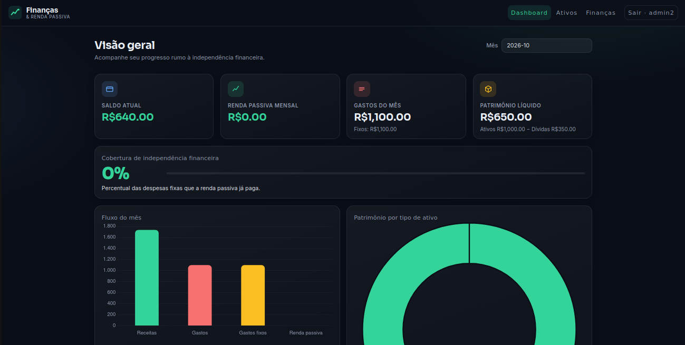
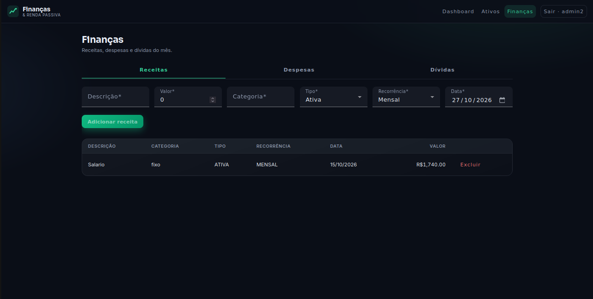
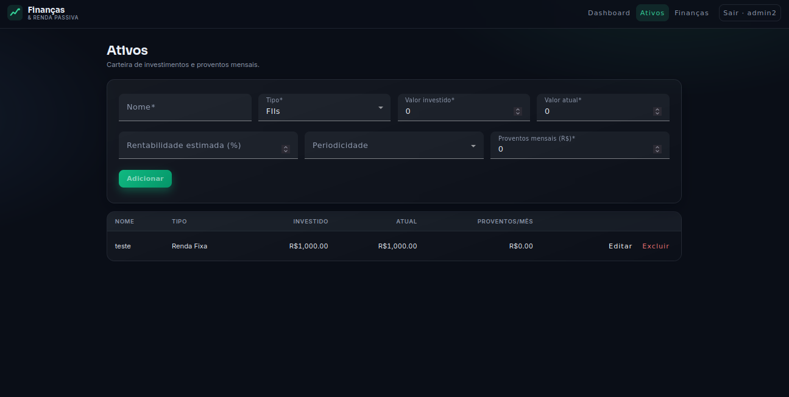

#  Projeto de Estudo 💰 Finanças & Renda Passiva

##  Funcionalidades

###  Dashboard Interativo
- Visão geral do patrimônio líquido
- Renda passiva mensal estimada
- Gastos do mês (fixos e variáveis)
- Gráfico de fluxo de caixa (receitas vs despesas)
- Gráfico de distribuição de ativos
- Cálculo de cobertura de independência financeira

###  Gestão de Finanças
- Cadastro de receitas (salários, proventos, outros)
- Controle de despesas (fixas e variáveis)
- Registro de dívidas
- Categorização automática
- Recorrência mensal

###  Carteira de Ativos
- Cadastro de investimentos (FIIs, Ações, Renda Fixa, etc.)
- Acompanhamento de valor investido vs valor atualizado
- Proventos mensais estimados
- Rentabilidade por tipo de ativo
- Evolução patrimonial

###  Autenticação e Segurança
- Login seguro com JWT
- Criptografia de senhas (BCrypt)
- Sessões protegidas
- CORS configurado

---

##  Telas do Sistema

### 🔐 Página de Login
Interface simples e segura para acesso ao sistema.

### 📊 Dashboard Principal
Acompanhamento completo do patrimônio e métricas financeiras em tempo real.

### 💵 Gestão de Finanças
Cadastro e controle de receitas, despesas e dívidas com categorização.

###  Carteira de Ativos
Gerenciamento completo da carteira de investimentos e proventos.

---

## 🛠️ Tecnologias Utilizadas

### Backend
- **Java 21** - Linguagem principal
- **Spring Boot 3.3.4** - Framework principal
- **Spring Security** - Autenticação e autorização
- **Spring Data JPA** - Persistência de dados
- **PostgreSQL** - Banco de dados relacional
- **Flyway** - Migrações de banco de dados
- **JWT (JSON Web Tokens)** - Autenticação stateless
- **BCrypt** - Criptografia de senhas
- **Maven** - Gerenciamento de dependências
- **HikariCP** - Connection pool

### Frontend
- **Angular/React** - Framework frontend 
- **TypeScript** - Linguagem tipada
- **HTML5/CSS3** - Estrutura e estilo
- **Chart.js/ApexCharts** - Gráficos interativos 

